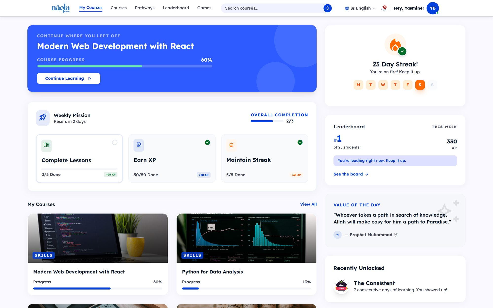
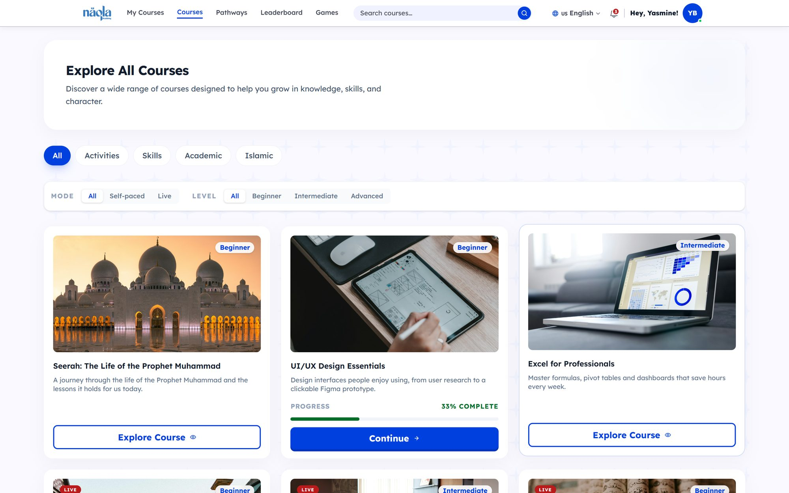
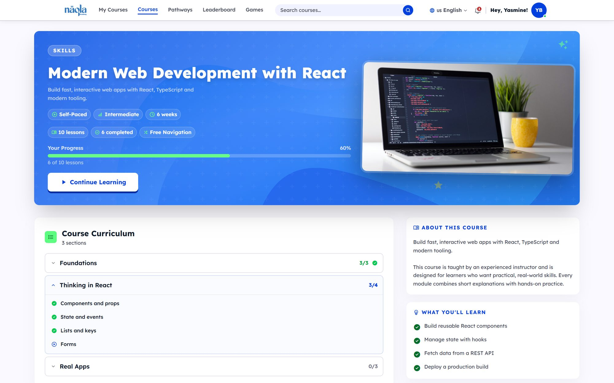
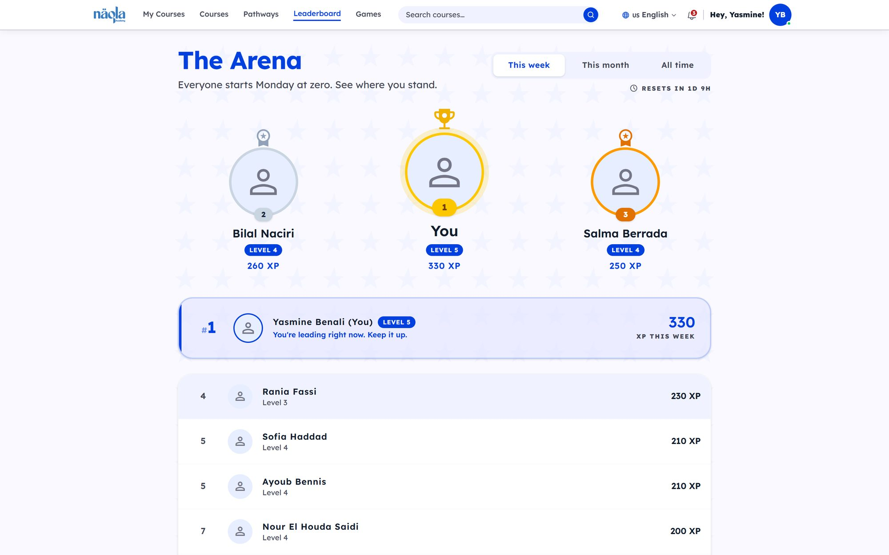
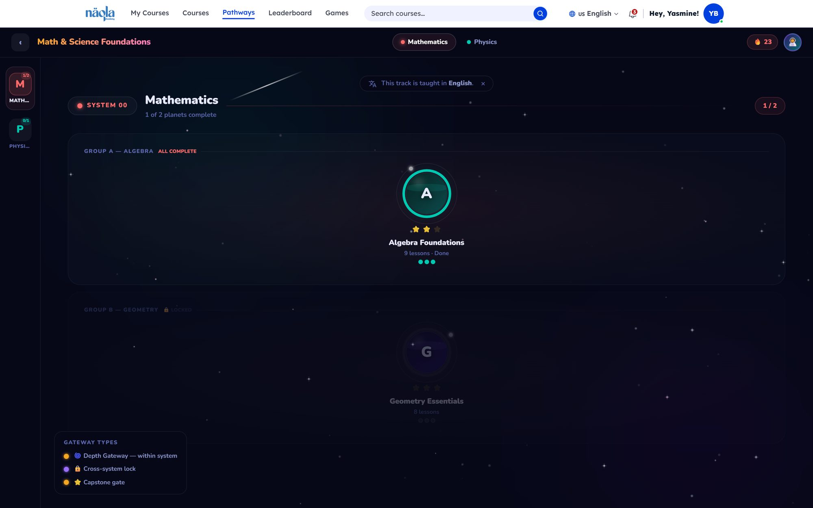
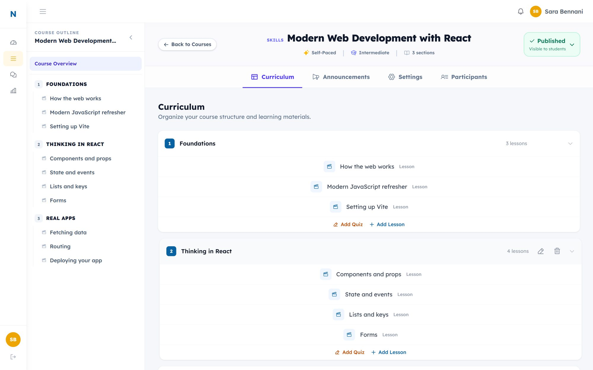
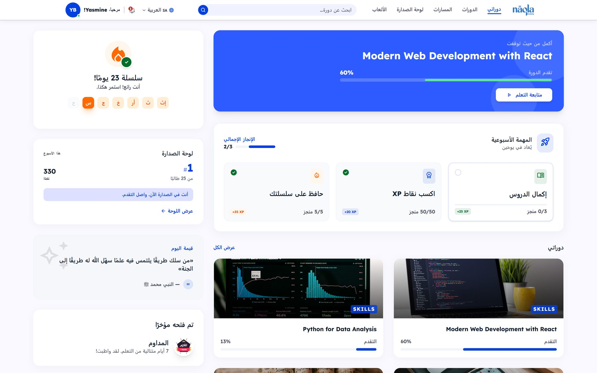
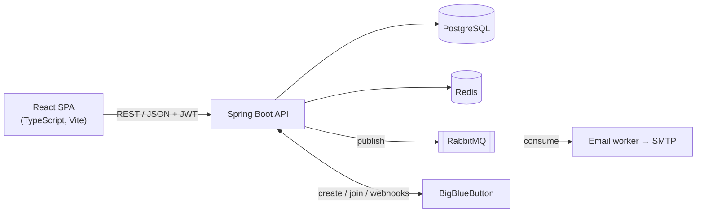

# Naqla Academy: case study

An online learning platform with self-paced courses, live virtual classes, assessments and gamification, in **English and Arabic** (full right-to-left layout).

**My role:** sole developer, from database design to UI (April 2026 – today).
**Status:** in production development for a client. **The source code is private**, but I'm happy to give a live code walkthrough.

Screenshots use demo data. Course photos are from [Unsplash](https://unsplash.com).

---

## At a glance

| | |
|---|---|
| **Backend** | Java 21, Spring Boot 4, Spring Security, Spring Data JPA, PostgreSQL 16, Flyway |
| **Infrastructure** | Redis (rate limiting, token revocation), RabbitMQ (async email), Docker Compose |
| **Frontend** | React 19, TypeScript, Vite, Tailwind CSS 4, TanStack Query, Zustand |
| **Integrations** | BigBlueButton (live classes), Google sign-in, SMTP email templates |
| **Size** | 19 backend modules · 50+ database migrations · 1,000+ automated backend tests |

## What it does

**Students:** course catalog and enrollment, a lesson player, learning paths ("Pathways"), quizzes and assignments, live classes in the browser, XP, badges, streaks, a weekly leaderboard, PDF certificates and in-app notifications.

**Instructors:** a course builder with a rich-text editor, quiz and assignment authoring and grading, live-session scheduling and announcements.

**Admins:** user and role management, a course approval workflow and a contact inbox.

| | |
|---|---|
|  **Course catalog** with filters |  **Course home** with progress and curriculum |
|  **Leaderboard:** weekly, monthly, all time |  **Learning path** drawn as a galaxy map |
|  **Instructor course editor** |  **Arabic interface**, right-to-left |

## Architecture

The backend is a **modular monolith**: one deployable application split into 19 feature modules (`auth`, `course`, `assessment`, `live`, `notification`, `gamification`, …). Every module has the same layers (controller → service → repository) and talks to other modules through **Spring application events**. For example, grading an assignment publishes an event that the notification module handles. The modules stay loosely coupled, without the operational cost of microservices.

The frontend is organized **by feature**: each feature folder holds its own pages, components, API hooks and translations.

## Problems I solved

**Keeping sessions secure without logging people out by mistake**
Access tokens are short-lived JWTs kept only in memory; refresh tokens are httpOnly cookies that rotate on every use. If an old refresh token is reused, the server ends that session. Two edge cases needed extra care:
- two browser tabs refreshing at the same moment, handled with a short grace window;
- the server restarting during a deploy: only a real `4xx` answer logs the user out, while network errors and `5xx` are retried.

**Notifications that never arrive twice**
Notifying a whole course is a single `INSERT … SELECT … ON CONFLICT DO NOTHING` with a deterministic dedupe key. A retried or double-fired event can't create duplicates, and no list of recipients is loaded into memory. A background worker sends scheduled reminders (live sessions 24 h / 1 h before, assignment deadlines 3 days / 24 h / 12 h before), and updates them when a session is moved or cancelled.

**Data integrity in the database, not just in Java**
Rules like "one active enrollment per student and course" are partial unique indexes in PostgreSQL, so they hold even under concurrent requests. Reordering lessons is one atomic `UPDATE … CASE` statement with optimistic locking, instead of many separate updates.

**Bilingual by design**
Notifications are stored as a type plus parameters and rendered in the reader's language when they're read, so switching to Arabic also translates old notifications. The interface fully mirrors for right-to-left.

**Performance**
I cut the initial JavaScript bundle from 337 KB to 206 KB (gzipped) with route-level code splitting, and removed N+1 query patterns from list endpoints.

## How I work

- **Design before code:** larger features (notifications, live messaging, assessments) start with a written design document and a phased build plan.
- **Test what matters:** unit tests for service logic, web-layer tests for security rules and validation, and persistence tests for constraints and migrations.
- **Manual QA, page by page:** login, registration, password reset, dashboard and course pages, including edge cases like expired links, concurrent tabs and server restarts. Every bug found got a fix and a regression test.
- **Small, focused commits** with clear messages.

---

← [Back to my profile](README.md)
